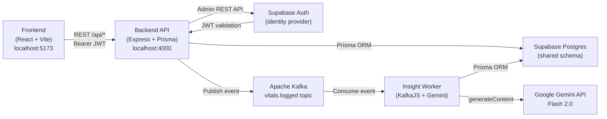
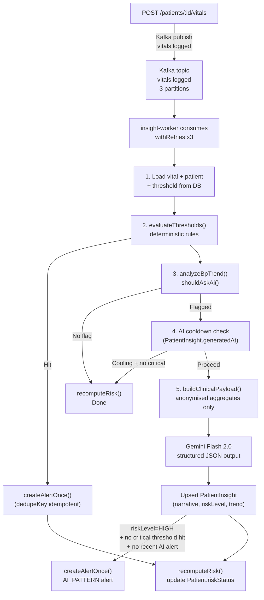
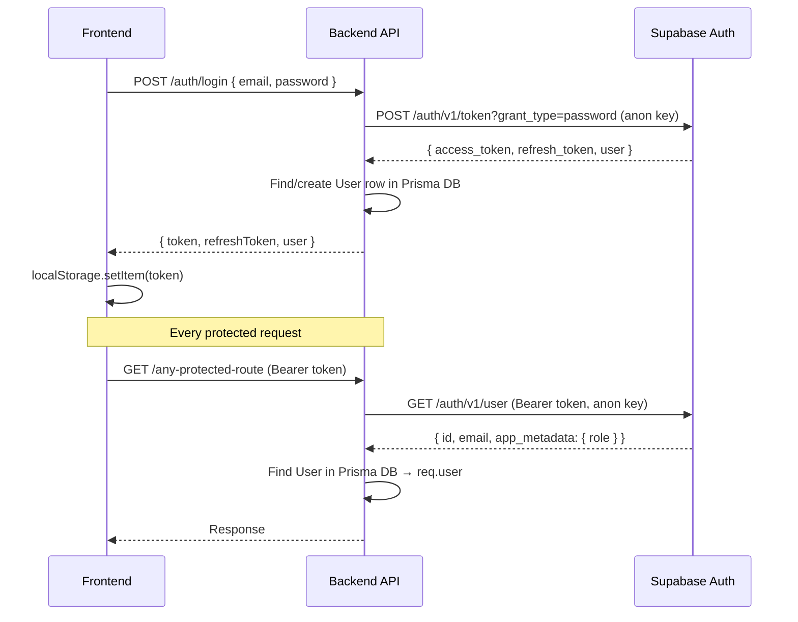

# HealthLens — Architecture Reference

> Generated: 2026-10-16. Single source of truth for structure, APIs, schema, and design decisions.

---

## 1. What is HealthLens?

HealthLens is a **chronic-disease remote monitoring platform** that connects patients with their assigned physician. Patients log daily vitals (blood pressure, glucose, weight, sleep). An AI-assisted backend continuously analyses those readings, fires threshold alerts, and generates weekly plain-language health summaries. Doctors get a real-time dashboard showing their entire patient roster, risk tiers, and actionable alerts.

### Target Users

| Persona | Description |
|---|---|
| **Patient** | A person with one or more chronic conditions (hypertension, diabetes, heart disease). Logs vitals daily from a mobile browser or desktop. Reads AI-generated weekly summaries and sees alerts their doctor has shared. |
| **Doctor / Clinician** | A physician or clinic that manages a panel of patients. Reviews the roster for at-risk patients, sets per-patient alert thresholds, adds clinical notes to alerts, and registers new patients. |

### Core Value Propositions
- **Proactive alerting** — deterministic threshold rules fire before the patient even calls the clinic.
- **AI trend analysis** — Gemini scans multi-week BP/glucose patterns and writes a plain-English clinical narrative.
- **Zero-friction patient onboarding** — doctor creates the patient account; the patient gets a temporary password to log in immediately.
- **Role-scoped data** — patients see only their own data; doctors see only their assigned patients.

---

## 2. High-Level Architecture



### Component Summary

| Component | Tech | Port | Responsibility |
|---|---|---|---|
| **frontend** | React 18, Vite, Tailwind CSS | 5173 | UI for both patient and doctor |
| **backend** | Express, Prisma, TypeScript | 4000 | REST API, auth, patient CRUD |
| **insight-worker** | KafkaJS, Prisma, Google Gemini | — | Event consumer, rules engine, AI analysis |
| **Supabase** | Hosted Postgres + Auth | — | Database + identity provider |
| **Kafka** | Apache Kafka | 9092 | Async event bus (vitals pipeline) |

---

## 3. Monorepo File Structure

```
HealthLens/
├── package.json                    # Root workspace
│
├── backend/
│   ├── .env.example
│   ├── prisma/
│   │   └── schema.prisma           # Single source of truth for DB schema
│   ├── reset.ts                    # Dev script: provision Supabase demo accounts
│   └── src/
│       ├── server.ts               # Entry point (listen + graceful shutdown)
│       ├── app.ts                  # createApp() — mounts middleware + routers
│       ├── config.ts               # Env-var loading (Supabase keys, port, Kafka)
│       ├── db/
│       │   └── index.ts            # Prisma client singleton
│       ├── kafka/
│       │   └── producer.ts         # publishVitalLoggedEvent()
│       ├── lib/
│       │   ├── supabase.ts         # supabaseAdmin (Supabase JS client, service role)
│       │   ├── supabaseAuth.ts     # supabaseLogin / supabaseGetUser / adminCreateUser
│       │   ├── jwt.ts              # Legacy signToken/verifyToken (not used for auth)
│       │   └── provision.ts        # Dev helper: ensure demo users exist
│       ├── middleware/
│       │   ├── auth.ts             # requireAuth (Supabase token → req.user), requireRole
│       │   ├── errorHandler.ts     # Global Express error handler
│       │   └── requireRole.ts      # Standalone role guard (used in alerts routes)
│       └── modules/
│           ├── auth/
│           │   ├── auth.routes.ts  # /auth/*
│           │   └── auth.service.ts # login(), registerDoctor(), refresh(), changePassword()
│           ├── doctor/
│           │   └── doctor.routes.ts # /doctor/*
│           ├── patients/
│           │   └── patients.routes.ts # /patients/*
│           └── alerts/
│               ├── alerts.routes.ts   # /alerts/*
│               └── alertSerializer.ts # alertForDoctor() / alertForPatient()
│
├── frontend/
│   ├── .env.example
│   ├── vite.config.ts
│   └── src/
│       ├── main.tsx                # React entry, BrowserRouter
│       ├── App.tsx                 # Route tree (all routes declared here)
│       ├── types/
│       │   └── index.ts            # All shared TypeScript interfaces
│       ├── context/
│       │   ├── AuthContext.tsx     # login/registerDoctor/logout, token in localStorage
│       │   └── ToastContext.tsx    # Global toast notifications
│       ├── lib/
│       │   ├── constants.ts        # TOKEN_STORAGE_KEY, USER_STORAGE_KEY
│       │   └── utils.ts            # cx() classname helper
│       ├── routes/
│       │   └── ProtectedRoute.tsx  # Role-based route guard
│       ├── services/               # API layer (all fetch calls)
│       │   ├── apiClient.ts        # Thin fetch wrapper (USE_MOCKS toggle)
│       │   ├── authService.ts      # login, registerDoctor, logout
│       │   ├── vitalsService.ts    # submitVitals, getVitals, getVitalsLog
│       │   ├── patientsService.ts  # getPatient, getRoster, createPatient, updatePatient, deletePatient
│       │   ├── alertsService.ts    # getAlerts, updateAlert, requestFollowUp
│       │   ├── thresholdsService.ts # getThresholds, saveThresholds
│       │   ├── insightsService.ts  # getInsights, getWeeklySummaries
│       │   └── mockData.ts         # In-memory mock data (VITE_USE_MOCKS=true)
│       ├── components/
│       │   ├── layout/
│       │   │   ├── DoctorLayout.tsx    # Sidebar + outlet for doctor pages
│       │   │   ├── PatientLayout.tsx   # Bottom tab bar + outlet for patient pages
│       │   │   ├── Sidebar.tsx
│       │   │   ├── BottomTabBar.tsx
│       │   │   ├── NotificationBell.tsx
│       │   │   ├── UserMenu.tsx
│       │   │   └── icons.tsx
│       │   ├── charts/
│       │   │   ├── BPChart.tsx         # Blood pressure line chart (Recharts)
│       │   │   ├── GlucoseChart.tsx    # Glucose line chart
│       │   │   ├── WeightSleepChart.tsx
│       │   │   └── TrendSparkline.tsx  # Mini sparkline for dashboard
│       │   └── ui/
│       │       ├── Button.tsx
│       │       ├── Card.tsx
│       │       ├── Modal.tsx
│       │       ├── Badge.tsx
│       │       ├── Spinner.tsx
│       │       └── StatStrip.tsx
│       └── pages/
│           ├── LoginPage.tsx           # Login + Doctor Registration (mode switcher)
│           ├── doctor/
│           │   ├── Dashboard.tsx       # Roster, stats, Add/Edit/Delete patient modals
│           │   ├── PatientDetail.tsx   # Per-patient vitals, alerts, AI insight
│           │   ├── Alerts.tsx          # Alert feed with filters
│           │   ├── Thresholds.tsx      # Per-patient threshold configuration
│           │   ├── Profile.tsx         # Doctor's own profile editor
│           │   └── Settings.tsx        # Account settings, password change
│           └── patient/
│               ├── Dashboard.tsx       # Latest metrics + sparkline + AI summary
│               ├── LogVitals.tsx       # Vitals submission form
│               ├── Trends.tsx          # Charts (7d/30d/90d toggle)
│               ├── Insights.tsx        # Weekly AI summaries
│               ├── Profile.tsx         # Patient's own profile
│               └── Settings.tsx        # Password change
│
└── insight-worker/
    ├── prisma/
    │   └── schema.prisma           # Mirror of backend schema (shared Supabase DB)
    └── src/
        ├── index.ts                # Kafka consumer + scheduler bootstrap
        ├── config.ts               # KAFKA_BROKER, GEMINI_API_KEY, cooldown config
        ├── db.ts                   # Prisma client singleton
        ├── events.ts               # vitalsLoggedSchema (Zod)
        ├── util.ts                 # withRetries()
        ├── ai/
        │   ├── gemini.ts           # generateJson() — Gemini API wrapper
        │   ├── prompts.ts          # CLINICAL_SYSTEM + clinicalPrompt()
        │   └── schemas.ts          # clinicalAnalysisSchema (Zod + JSON schema)
        ├── rules/
        │   ├── constants.ts        # CLINICAL defaults, resolveThresholds()
        │   ├── thresholds.ts       # evaluateThresholds() — deterministic rules
        │   └── trends.ts           # analyzeBpTrend(), shouldAskAi()
        ├── schedulers/
        │   └── index.ts            # Weekly summary cron scheduler
        ├── services/
        │   ├── analyzer.ts         # processVitalEvent() — main pipeline
        │   ├── alerts.ts           # createAlertOnce(), recomputeRisk()
        │   └── weeklySummary.ts    # generateWeeklySummary()
        └── scripts/
            ├── seed.ts             # Seed script for dev data
            ├── publishEvent.ts     # Manual event publisher for testing
            └── runWeeklySummary.ts # Run weekly summary on demand
```

---

## 4. Frontend Routes

| Path | Component | Role | Description |
|---|---|---|---|
| `/` | `RootRedirect` | any | Redirects to dashboard based on role |
| `/login` | `LoginPage` | public | Sign-in + Doctor Registration tab |
| `/register` | `LoginPage` | public | Same page, opens in register mode |
| `/patient/dashboard` | `PatientDashboard` | patient | Metrics, sparkline, AI summary, alerts |
| `/patient/log-vitals` | `LogVitals` | patient | Vitals submission form |
| `/patient/trends` | `Trends` | patient | BP/glucose/weight/sleep charts |
| `/patient/insights` | `Insights` | patient | Weekly AI-generated summaries |
| `/patient/profile` | `Profile` | patient | View/edit personal info |
| `/patient/settings` | `PatientSettings` | patient | Password change |
| `/doctor/dashboard` | `DoctorDashboard` | doctor | Roster + overview stats + Add/Edit patient |
| `/doctor/patients/:id` | `PatientDetail` | doctor | Per-patient vitals, alerts, AI insight |
| `/doctor/patients/:id/thresholds` | `Thresholds` | doctor | Per-patient alert threshold editor |
| `/doctor/alerts` | `Alerts` | doctor | Alert feed with status/type filters |
| `/doctor/profile` | `DoctorProfile` | doctor | View/edit clinic name, phone |
| `/doctor/settings` | `DoctorSettings` | doctor | Password change |

---

## 5. Backend REST API

Base URL: `http://localhost:4000/api`
Auth: `Authorization: Bearer <supabase-access-token>`

### Auth — [`auth.routes.ts`](/backend/src/modules/auth/auth.routes.ts)

| Method | Path | Auth | Description |
|---|---|---|---|
| `POST` | `/auth/login` | — | Password login via Supabase → returns `{ token, refreshToken, user }` |
| `POST` | `/auth/refresh` | — | Exchange refresh token for new access token |
| `POST` | `/auth/register-doctor` | — | Register new doctor in Supabase Auth + DB |
| `POST` | `/auth/register` | — | Alias for register-doctor (defaults clinic to "HealthLens Clinic") |
| `POST` | `/auth/logout` | — | Stateless; client clears token |
| `GET` | `/auth/me` | ✅ | Return current user's profile + clinicName/phone |
| `PATCH` | `/auth/password` | ✅ | Change password (validates current password first) |

### Doctor — [`doctor.routes.ts`](/backend/src/modules/doctor/doctor.routes.ts)

> All routes require `DOCTOR` role. A `Doctor` DB row must exist or 403 is returned.

| Method | Path | Description |
|---|---|---|
| `GET` | `/doctor/overview` | Dashboard summary: total patients, critical alerts count, missing readings in 48h, roster, urgent alerts |
| `GET` | `/doctor/patients` | Roster with optional `?search=` and `?filter=all\|critical\|needs_review` |
| `POST` | `/doctor/patients` | Create patient: registers in Supabase Auth (admin API), creates `User` + `Patient` + `ChronicCondition` + `PatientThreshold` rows in a transaction. Returns row + `temporaryPassword` (shown once). Optional initial vitals can be included. |
| `GET` | `/doctor/patients/:id` | Full patient detail: profile, AI insight, alert history (last 10), vitals (last 90 days, up to 500 rows) |
| `PATCH` | `/doctor/patients/:id` | Edit patient (name, email, phone, DOB, gender, conditions, riskStatus). Email change is mirrored to Supabase Auth first; rolls back on DB failure. |
| `DELETE` | `/doctor/patients/:id` | Unassign patient from this doctor (sets `doctorId = null`). Account + data preserved. |
| `PATCH` | `/doctor/profile` | Update doctor's name, clinic name, phone |
| `GET` | `/doctor/patients/:id/thresholds` | Get per-patient alert thresholds (falls back to schema defaults) |
| `PUT` | `/doctor/patients/:id/thresholds` | Save per-patient alert thresholds (upsert) |

### Patients — [`patients.routes.ts`](/backend/src/modules/patients/patients.routes.ts)

> `:id` can be the patient's `Patient.id`, `Patient.userId`, or `"me"` (resolved from auth token).
> Authorization: patient can access their own records; doctor can access their assigned patients.

| Method | Path | Description |
|---|---|---|
| `GET` | `/patients/:id/profile` | Patient profile (name, DOB, gender, phone, conditions, assigned doctor) |
| `PATCH` | `/patients/:id/profile` | Update patient's own profile (phone, gender, name) |
| `GET` | `/patients/:id/dashboard` | Dashboard snapshot: latest metrics, sparkline (7 days), recent alerts, AI insight |
| `POST` | `/patients/:id/vitals` | Submit a vitals reading → saved to DB → Kafka event published |
| `GET` | `/patients/:id/vitals` | Trend data for charts (`?range=7d\|30d\|90d`) + per-metric stats |
| `GET` | `/patients/:id/vitals/log` | Paginated vitals log (`?page=1&pageSize=20`) |
| `GET` | `/patients/:id/summaries` | All weekly AI summaries for this patient |
| `GET` | `/patients/:id/alerts/history` | Full alert history (serialized differently for doctor vs patient) |

### Alerts — [`alerts.routes.ts`](/backend/src/modules/alerts/alerts.routes.ts)

> All routes require `DOCTOR` role.

| Method | Path | Description |
|---|---|---|
| `GET` | `/alerts` | All alerts for this doctor's patients (`?status=unread\|acknowledged\|resolved&type=threshold\|ai_pattern`) |
| `PATCH` | `/alerts/:id` | Update alert status, add/clear clinical note, toggle `noteSharedWithPatient` |
| `POST` | `/alerts/:id/follow-up` | Request patient follow-up with optional note (always patient-visible) |

---

## 6. Insight Worker Event Pipeline

Triggered every time a patient submits a vitals reading.



### Deterministic Rules ([`thresholds.ts`](/insight-worker/src/rules/thresholds.ts))

| Rule | Trigger | Severity |
|---|---|---|
| `BP_THRESHOLD` | Systolic > `systolicMax` OR diastolic > `diastolicMax` | CRITICAL |
| `GLUCOSE_LOW` | Glucose < `glucoseFastingMin` | CRITICAL |
| `GLUCOSE_VERY_HIGH` | Glucose ≥ 400 mg/dL (clinical emergency) | CRITICAL |
| `GLUCOSE_FASTING_HIGH` | Fasting glucose > `glucoseFastingMax` | CAUTION |
| `GLUCOSE_POST_MEAL_HIGH` | Post-meal glucose > `glucosePostMealMax` | CAUTION |
| `WEIGHT_DELTA` | Weight change ≥ `weightDeltaKg` in `weightDeltaDays` days | CAUTION |

### AI Analysis
- **Model**: Gemini Flash 2.0 (`generateContent` with `responseSchema`)
- **Input**: Anonymised aggregates only (no name, email, DOB — only condition labels, averages, trend slope, R², reading counts)
- **Output**: `{ riskLevel: LOW|MODERATE|HIGH, trend: RISING|STABLE|FALLING, rationale: string }`
- **Cooldown**: configurable `AI_COOLDOWN_HOURS` (default 6h) prevents redundant API calls
- **AI alert suppression**: `AI_PATTERN` alert only raised if no similar alert in last 3 days

---

## 7. Database Schema

Hosted on **Supabase Postgres**. Schema managed via Prisma migrations from `/backend`.

```mermaid
erDiagram
    User {
        String id PK
        String email UK
        String password
        String name
        Role role
        DateTime createdAt
        DateTime updatedAt
    }
    Doctor {
        String id PK
        String userId FK
        String clinicName
        String phone
    }
    Patient {
        String id PK
        String userId FK
        String doctorId FK
        DateTime doctorAssignedAt
        DateTime dateOfBirth
        String gender
        String phone
        RiskStatus riskStatus
        DateTime lastReadingAt
    }
    ChronicCondition {
        String id PK
        String patientId FK
        String label
    }
    Vital {
        String id PK
        String patientId FK
        Int systolic
        Int diastolic
        Float glucose
        GlucoseContext glucoseContext
        Float weightKg
        Float sleepHours
        Int heartRate
        DateTime recordedAt
    }
    PatientThreshold {
        String patientId PK_FK
        Int systolicMax
        Int diastolicMax
        Int glucoseFastingMax
        Int glucoseFastingMin
        Int glucosePostMealMax
        Float weightDeltaKg
        Int weightDeltaDays
    }
    Alert {
        String id PK
        String patientId FK
        String acknowledgedById FK
        AlertType type
        AlertSeverity severity
        AlertStatus status
        String rule
        String triggerLabel
        String detail
        String aiRationale
        Json metrics
        String vitalId
        String dedupeKey UK
        String clinicalNote
        Boolean noteSharedWithPatient
        DateTime followUpRequestedAt
        String followUpNote
        DateTime triggeredAt
    }
    PatientInsight {
        String patientId PK_FK
        String narrative
        AiRiskLevel riskLevel
        String trend
        Json stats
        DateTime generatedAt
    }
    WeeklySummary {
        String id PK
        String patientId FK
        DateTime weekStart
        DateTime weekEnd
        String narrative
        String[] takeaways
        String trend
        Json stats
    }

    User ||--o| Doctor : "has"
    User ||--o| Patient : "is"
    Doctor ||--o{ Patient : "manages"
    Patient ||--o{ ChronicCondition : "has"
    Patient ||--o{ Vital : "logs"
    Patient ||--o| PatientThreshold : "has"
    Patient ||--o{ Alert : "receives"
    Patient ||--o| PatientInsight : "has"
    Patient ||--o{ WeeklySummary : "has"
    Doctor ||--o{ Alert : "acknowledges"
```

### Key Design Decisions in Schema

- **`User` is the identity anchor** — both `Doctor` and `Patient` are 1-to-1 extensions. This avoids duplicating email/name.
- **`Patient.riskStatus`** is maintained by the insight-worker (not computed on read) so the doctor roster query is a cheap indexed scan.
- **`Alert.dedupeKey`** is unique — makes Kafka redelivery and retry loops fully idempotent.
- **`PatientInsight`** is a single-row cache (one per patient) — the insight-worker upserts it, so no Redis is needed for cooldown.
- **`PatientThreshold`** has defaults matching clinical guidelines — missing rows in the worker fall back gracefully.
- **All measurements in `Vital` are nullable** — a patient can log only BP or only glucose in one submission.

---

## 8. Authentication Flow



### Role Encoding
- `app_metadata.role` in Supabase stores `"DOCTOR"` or `"PATIENT"` (set at creation by the service-role Admin API).
- The middleware reads this to populate `req.user.role`.
- Patients cannot modify `app_metadata` (unlike `user_metadata`).

---

## 9. Design & Technology Choices

### Frontend
| Choice | Rationale |
|---|---|
| **React 18 + Vite** | Fast HMR in dev; small production bundle. |
| **Tailwind CSS** | Utility-first, design-token consistent (custom `ink`, `teal`, `brick` palette). No CSS-in-JS runtime. |
| **React Router v6** | Nested layouts (`DoctorLayout` / `PatientLayout`) with role-based `ProtectedRoute`. |
| **`VITE_USE_MOCKS`** | Entire service layer switches between real API and in-memory mock data — no code change required for UI-only development. |
| **`localStorage` for token** | Standard SPA approach. Real Supabase JWTs are short-lived (~1h); a refresh token handles renewal. No fake tokens are ever stored. |
| **No global state library** | `AuthContext` + `ToastContext` cover shared state. Per-page data is fetched on mount with `useEffect`. Avoids Redux boilerplate at this scale. |

### Backend
| Choice | Rationale |
|---|---|
| **Express + TypeScript** | Familiar, minimal overhead. Type-safety through Prisma-generated types. |
| **Prisma ORM** | Schema-first, typed queries, migration tooling, works seamlessly with Supabase Postgres. |
| **Supabase Auth (Admin API)** | Doctor creates patients server-side with `email_confirm: true` — no email round-trip. Service-role key stays server-only. |
| **Anon key for login/token validation** | Password grant tokens must be minted with the anon key; service-role key is admin-only. |
| **Module-per-resource routing** | Each domain (`auth`, `doctor`, `patients`, `alerts`) lives in its own file. Easy to navigate and extend. |
| **Transaction for patient creation** | Supabase user is created first (can't be rolled back by Postgres); on DB failure, the Supabase user is deleted manually as compensation. |

### Insight Worker
| Choice | Rationale |
|---|---|
| **Kafka (not webhooks)** | Decoupled: API responds to patient instantly; analysis is async. Redelivery + DLQ gives durability without saga complexity. |
| **Deterministic rules before AI** | A BP of 200/120 fires a `CRITICAL` alert even if Gemini is down. AI never gates safety-critical paths. |
| **Gemini Flash 2.0 with structured output** | JSON schema output (`responseSchema`) avoids prompt engineering for parsing. Flash model is cheap enough for per-reading calls at this scale. |
| **Privacy-preserving AI payload** | Only statistical aggregates (averages, slopes, counts) + condition labels reach Gemini. No PII (name, email, DOB) is sent to the LLM. |
| **`dedupeKey` for idempotency** | Kafka-at-least-once delivery + exponential retry means the same event may be processed twice. Unique `dedupeKey` makes `createAlertOnce()` safe. |

---

## 10. Environment Variables

### `backend/.env`

| Variable | Required | Description |
|---|---|---|
| `DATABASE_URL` | ✅ | Supabase pooled Postgres URL (port 6543, `?pgbouncer=true`) |
| `DIRECT_URL` | ✅ | Direct Postgres URL (port 5432) — Prisma migrations only |
| `SUPABASE_URL` | ✅ | Supabase project URL |
| `SUPABASE_ANON_KEY` | ✅ | Public anon key — used for login and token validation |
| `SUPABASE_SERVICE_ROLE_KEY` | ✅ | Secret service-role key — used for admin user creation |
| `SUPABASE_JWT_SECRET` | optional | JWT secret (not used in middleware; kept for reference) |
| `PORT` | optional | API port (default: `4000`) |
| `JWT_SECRET` | optional | Legacy fallback (not used for auth logic) |
| `KAFKA_BROKER` | optional | Kafka broker address (default: `localhost:9092`) |

### `frontend/.env`

| Variable | Required | Description |
|---|---|---|
| `VITE_API_BASE_URL` | optional | Backend URL (default: `http://localhost:4000/api`) |
| `VITE_USE_MOCKS` | optional | `"false"` = real API; omit or `"true"` = mock data |

---

## 11. What's Not Yet Built (Known Gaps)

| Feature | Status | Notes |
|---|---|---|
| **Token refresh on expiry** | ❌ Not wired | `POST /auth/refresh` endpoint exists; frontend doesn't auto-call it when a 401 is received |
| **Patient self-registration** | ❌ Not built | Patients are always created by their doctor |
| **Notifications / push** | ❌ Not built | Alerts live in DB; no push or email delivery |
| **Doctor ↔ patient chat** | ❌ Not built | Follow-up notes are one-way (doctor writes, patient reads via alert) |
| **Heart rate in vitals form** | ❌ Not surfaced | `heartRate` column exists in DB; LogVitals form doesn't include it yet |
| **Weekly summary scheduler** | ⚠️ Partial | `schedulers/index.ts` exists; exact cron trigger needs verifying |
| **Supabase RLS policies** | ❌ Not set | DB security relies on backend scoping, not row-level security |
| **Offline / PWA** | ❌ Not built | No service worker |
